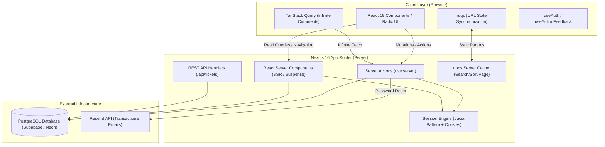

# TicketBounty — Full-Stack Bounty & Ticket Management System

TicketBounty is an enterprise-grade, full-stack issue tracking and bounty collaboration platform built with **Next.js 16 (App Router)**, **React 19**, **Prisma ORM**, **Lucia-pattern session authentication**, and **Tailwind CSS v4**.

It bridges task tracking with financial incentives by allowing developers and teams to create, track, manage, and collaborate on software issues with attached cash bounties.

---

## 📑 Table of Contents

- [Overview & Core Purpose](#-overview--core-purpose)
- [System Architecture](#-system-architecture)
- [Tech Stack](#-tech-stack)
- [Directory Structure & Module Breakdown](#-directory-structure--module-breakdown)
- [Key Architectural Patterns](#-key-architectural-patterns)
- [Environment Variables & Configuration](#-environment-variables--configuration)
- [Local Development Guide](#-local-development-guide)
- [Production Deployment Guide](#-production-deployment-guide)
- [Available Scripts](#-available-scripts)

---

## 🎯 Overview & Core Purpose

TicketBounty is designed to streamline open and private issue resolution by attaching quantifiable value to tickets:

- **Bounty Allocation & Accounting:** Tickets carry dollar-denominated bounties calculated and persisted with precision (cent-level integers backed by `big.js`).
- **Complete Ticket Lifecycle (CRUD):** Ticket creation, markdown content descriptions, deadlines, status transitions (`OPEN`, `IN_PROGRESS`, `DONE`), and deletion with fine-grained authorization.
- **Real-Time Collaboration & Discussion:** Infinite-scrolling discussion threads on each ticket, powered by TanStack Query and Intersection Observer.
- **Server-Driven Querying & URL State:** Deep linking, search with debouncing, multi-field sorting, and pagination synchronized with the browser URL via `nuqs`.
- **Identity & Session Security:** Self-contained token-based session management using SHA-256 token hashing, Argon2 password cryptography, sliding expiration windows, and transactional password recovery emails via Resend.

---

## 🏛 System Architecture

The application adopts a **Vertical Slice / Feature-Driven Architecture**, cleanly separating domain concerns while leveraging Next.js 16 Server Components and Server Actions.



---

## 🛠 Tech Stack

### Core Framework & Runtime
| Technology | Version | Purpose |
| :--- | :--- | :--- |
| [Next.js](https://nextjs.org/) | `^16.0.7` | App Router, React Server Components, Server Actions, Route Handlers |
| [React](https://react.dev/) | `19.2.0` | Modern React runtime with React Compiler support (`reactCompiler: true`) |
| [TypeScript](https://www.typescriptlang.org/) | `^5` | Strict static type safety throughout the codebase |

### Database & ORM
| Technology | Version | Purpose |
| :--- | :--- | :--- |
| [PostgreSQL](https://www.postgresql.org/) | — | Relational database storage |
| [Prisma ORM](https://www.prisma.io/) | `^5.22.0` | Type-safe query engine, migrations, schema modeling, and client generation |
| Dual Connection Pooling | — | Direct URL for migrations (`DIRECT_URL`) + pooled connection (`DATABASE_URL`) |

### Authentication & Cryptography
| Technology | Version | Purpose |
| :--- | :--- | :--- |
| [Lucia Pattern](https://lucia-auth.com/) | `^3.2.2` | Database-backed session engine with sliding expiration |
| [@node-rs/argon2](https://github.com/napi-rs/node-rs) | `^2.0.2` | Native high-performance Argon2 password hashing |
| [@oslojs/crypto](https://github.com/oslo-js) | `^1.0.1` | Cryptographic SHA-256 token hashing for sessions & reset tokens |
| [@oslojs/encoding](https://github.com/oslo-js) | `^1.1.0` | Base32 & Hex encoding for secure random tokens |

### UI, Styling & Motion
| Technology | Version | Purpose |
| :--- | :--- | :--- |
| [Tailwind CSS](https://tailwindcss.com/) | `^4.0` | Next-generation CSS framework using CSS `@theme` and OKLCH color spaces |
| [Radix UI](https://www.radix-ui.com/) | Latest | Accessible, unstyled UI primitives (Dialog, Dropdown, Tabs, Popover) |
| [Lucide React](https://lucide.dev/) | `^0.553.0` | Crisp, scalable SVG icons |
| [Sonner](https://sonner.emilkowal.ski/) | `^2.0.7` | Toast notifications with action feedback integration |
| [next-themes](https://github.com/pacocoursey/next-themes) | `^0.4.6` | Flawless Dark/Light mode theme switching with zero hydration flash |
| [tw-animate-css](https://github.com/jamiebuilds/tailwindcss-animate) | `^1.4.0` | Keyframe and entrance animation utilities |

### State Management & URL Utilities
| Technology | Version | Purpose |
| :--- | :--- | :--- |
| [nuqs](https://nuqs.47ng.com/) | `^2.8.1` | Type-safe search param synchronization across server and client |
| [TanStack React Query](https://tanstack.com/query) | `^5.90.11` | Client-side cache, infinite query fetching for comments |
| [react-intersection-observer](https://github.com/thebuilder/react-intersection-observer) | `^10.0.0` | Viewport detection for automatic infinite scroll pagination |
| [big.js](https://mikemcl.github.io/big.js/) | `^7.0.1` | Arbitrary-precision decimal arithmetic for financial bounties |
| [zod](https://zod.dev/) | `^4.1.12` | Schema validation for forms, search parameters, and mutations |

### Communications
| Technology | Version | Purpose |
| :--- | :--- | :--- |
| [Resend](https://resend.com/) | `^6.6.0` | Transactional email delivery service |
| [React Email](https://react.email/) | `^1.0.1` | Clean, responsive email templates written as React components |

---

## 📁 Directory Structure & Module Breakdown

```
TicketBounty/
├── prisma/
│   ├── schema.prisma              # Data models: User, Session, Ticket, Comment, PasswordResetToken
│   └── seed.ts                    # Database seeder with sample accounts, tickets, and comments
├── public/                        # Static assets (SVGs, icons)
├── src/
│   ├── actions/
│   │   └── cookies.ts             # Generic cookie manipulation server actions (flash toast bridge)
│   ├── app/                       # Next.js App Router (pages, layouts, route handlers)
│   │   ├── (auth)/                # Route Group protected by AuthenticatedLayout
│   │   │   ├── layout.tsx         # Auth guard: calls getAuthOrRedirect()
│   │   │   ├── account/           # User account management (profile & password reset)
│   │   │   └── tickets/           # Authenticated ticket dashboard, creation, and detail views
│   │   │       ├── page.tsx       # "My Tickets" view (filtered by authenticated user)
│   │   │       └── [ticketId]/    # Single ticket details, edit page, comments feed
│   │   ├── _navigation/           # Global navigation components (Header, Sidebar, Account dropdown)
│   │   ├── _providers/            # App-level context providers (React Query, Nuqs, ThemeProvider)
│   │   ├── api/                   # REST API Route Handlers (/api/tickets, /api/tickets/[id])
│   │   ├── password-forgot/       # Public request password reset page
│   │   ├── password-reset/        # Public verify token & set new password page
│   │   ├── sign-in/               # Public sign-in page
│   │   ├── sign-up/               # Public account registration page
│   │   ├── layout.tsx             # Root layout with typography, theme, and toast providers
│   │   ├── page.tsx               # Public landing page: "All Tickets" across all users
│   │   └── globals.css            # Tailwind v4 configuration, OKLCH palettes, custom animations
│   ├── components/                # Shared reusable UI & layout components
│   │   ├── form/                  # Unified form handling: Form, FieldError, SubmitButton, ActionState
│   │   ├── theme/                 # ThemeProvider and ThemeSwitcher
│   │   ├── ui/                    # Shadcn / Radix primitives (Button, Input, Card, Dropdown, etc.)
│   │   ├── Heading.tsx            # Standardized page header banner
│   │   ├── Placeholder.tsx        # Empty-state feedback component
│   │   ├── redirect-toast.tsx     # Client bridge reading flash toast messages from cookies
│   │   └── search-input.tsx       # Debounced search input component
│   ├── emails/                    # React Email templates
│   │   └── password/              # Transactional password reset email layout
│   ├── features/                  # Vertical Domain Modules (Feature-Sliced Design)
│   │   ├── auth/                  # Authentication, sessions, sign-in/up/out actions, isOwner check
│   │   ├── comment/               # Comment CRUD actions, infinite-query feed, delete permissions
│   │   ├── password/              # Reset/forgot password actions, crypto token generator, email dispatcher
│   │   └── ticket/                # Ticket queries, search-params parser, upsert action, status updater
│   ├── lib/                       # Third-party client initializers & singletons
│   │   ├── big.ts                 # Configured Big.js singleton (Banker's rounding, DP: 2)
│   │   ├── lucia.ts               # Custom token-based session lifecycle logic
│   │   ├── prisma.ts              # Global PrismaClient singleton for HMR / serverless environments
│   │   ├── resend.ts              # Resend email client instance
│   │   └── utils.ts               # Tailwind CSS class merging helper (cn = clsx + twMerge)
│   ├── types/                     # Shared cross-cutting TypeScript definitions (Pagination, etc.)
│   ├── utils/                     # Pure utility helpers
│   │   ├── crypto.ts              # Token generator & SHA-256 hasher via @oslojs
│   │   ├── currency.ts            # Cent-to-dollar conversions & currency formatting
│   │   ├── get-active-path.ts     # Active route highlighter for navigation links
│   │   └── url.ts                 # Base URL resolution utility
│   └── paths.ts                   # Strongly-typed centralized application route constants
├── next.config.ts                 # Next.js configuration (React Compiler flag)
├── package.json                   # Dependencies, scripts, and package metadata
├── postcss.config.mjs             # PostCSS configuration for Tailwind v4
└── tsconfig.json                  # Strict TypeScript configuration and path aliases
```

---

## ⚡ Key Architectural Patterns

### 1. Unified Form State (`ActionState`)
Mutations throughout the application communicate with the UI using a standardized action state contract:
```typescript
export type ActionState<T = any> = {
  status?: "SUCCESS" | "ERROR";
  message: string;
  payload?: FormData;
  fieldErrors: Record<string, string[]> | undefined;
  timestamp: number;
  data?: T;
};
```
- Server Actions parse input with **Zod v4**.
- Any caught error is mapped via `fromErrorToActionState()` into field-specific validation errors or generic error messages.
- The client-side `<Form>` wrapper monitors state changes using the `useActionFeedback` hook and automatically triggers Sonner toasts.

### 2. URL-Driven State Management (`nuqs`)
Rather than keeping filter, sort, and pagination state in ephemeral client state:
- URL parameters (`search`, `sortKey`, `sortValue`, `page`, `size`) are validated and cached server-side using `createSearchParamsCache` from `nuqs/server`.
- This ensures full **Deep-Linking**, **SSR compatibility**, zero client-server hydration mismatch, and shareable filtered URLs.

### 3. Financial Bounty Representation
To eliminate floating-point precision bugs (e.g., `0.1 + 0.2 !== 0.3`):
- All monetary bounties are converted to integer cents using `toCent()` backed by `big.js` (Banker's Rounding: `Big.roundHalfEven`).
- Database columns store integer values (`bounty: Int`).
- Presentation components format cents into formatted USD strings via `Intl.NumberFormat`.

### 4. Sliding-Window Session Lifecycle
- Sessions are generated using high-entropy random byte arrays (20 bytes Base32).
- Only the **SHA-256 hash** of the session token is stored in the database.
- Sessions carry a 30-day maximum lifetime. When a user requests data with 15 days or fewer remaining, the session expiration is automatically extended by an additional 30 days.

---

## ⚙️ Environment Variables & Configuration

Create a `.env` file in the project root by copying the template below:

```env
# ==========================================
# Database Configuration (PostgreSQL / Supabase / Neon)
# ==========================================

# Transaction pooled connection URL (used at runtime by Prisma Client)
DATABASE_URL="postgresql://postgres:[PASSWORD]@[HOST]:6543/postgres?pgbouncer=true&connection_limit=1"

# Direct connection URL (used for migrations and schema push)
DIRECT_URL="postgresql://postgres:[PASSWORD]@[HOST]:5432/postgres"

# ==========================================
# Email Service Configuration (Resend)
# ==========================================

# Resend API Key for sending password reset emails
RESEND_API_KEY="re_123456789_abcdefg"

# ==========================================
# Host & Deployment Configuration
# ==========================================

# Base URL for email callback links and absolute redirects
# Local development: http://localhost:3000
# Production: https://yourdomain.com
NEXT_PUBLIC_VERCEL_URL="localhost:3000"
```

### Variable Reference
| Variable | Required | Description |
| :--- | :---: | :--- |
| `DATABASE_URL` | **Yes** | Connection string to PostgreSQL. For cloud DBs (Supabase/Neon), use the pooled connection string (port `6543`). |
| `DIRECT_URL` | **Yes** | Direct database connection (port `5432`). Required by Prisma for running migrations and `db push`. |
| `RESEND_API_KEY` | **Yes** | API key generated from [Resend](https://resend.com) to transmit transactional password recovery emails. |
| `NEXT_PUBLIC_VERCEL_URL` | Optional | Host domain used by `getBaseUrl()` when constructing password reset links. |

---

## 💻 Local Development Guide

### Prerequisites
- **Node.js**: `v20.x` or `v22.x` (LTS recommended)
- **Package Manager**: `npm` (v10+), `pnpm`, or `yarn`
- **Database**: A running PostgreSQL instance (local Docker container, Supabase, or Neon)

### Step-by-Step Setup

1. **Clone the repository:**
   ```bash
   git clone https://github.com/Mohamed-Y0/TicketBounty.git
   cd TicketBounty
   ```

2. **Install dependencies:**
   ```bash
   npm install
   ```
   *(Note: The `postinstall` script automatically executes `prisma generate` to compile the Prisma Client).*

3. **Configure Environment Variables:**
   Create a `.env` file in the project root and populate `DATABASE_URL`, `DIRECT_URL`, and `RESEND_API_KEY`.

4. **Initialize Database Schema:**
   Sync your Prisma schema with your development database:
   ```bash
   npx prisma db push
   ```

5. **Seed Initial Mock Data (Optional):**
   Populate test accounts, sample tickets with different statuses, and initial comments:
   ```bash
   npm run prisma-seed
   ```
   *Default Seed Credentials:*
   - Username: `admin` | Email: `admin@admin.com` | Password: `112233`
   - Username: `user` | Email: `mohamed.a.yehia9@gmail.com` | Password: `112233`

6. **Start the Development Server:**
   ```bash
   npm run dev
   ```
   Open [http://localhost:3000](http://localhost:3000) in your browser.

7. **Preview Email Templates (Optional):**
   Preview transactional emails locally using React Email's dedicated preview server:
   ```bash
   npm run email
   ```
   Open [http://localhost:3001](http://localhost:3001) to view and test email layouts.

---

## 🚀 Production Deployment Guide

### Deploying to Vercel (Recommended)

1. **Import Repository:** Connect your GitHub repository to [Vercel](https://vercel.com).
2. **Framework Preset:** Select **Next.js**.
3. **Environment Variables:** Set the following variables in the Vercel Dashboard:
   - `DATABASE_URL` (Use your pooled connection string, e.g., Supabase port `6543` with `?pgbouncer=true`).
   - `DIRECT_URL` (Direct connection string, port `5432`).
   - `RESEND_API_KEY` (Production Resend API key).
   - `NEXT_PUBLIC_VERCEL_URL` (Your production custom domain without `https://`, e.g., `tickets.yourdomain.com`).
4. **Build Command:** `prisma generate && next build` (or default `next build` if postinstall runs).
5. **Database Migration:** Run `npx prisma db push` or `npx prisma migrate deploy` in your CI/CD pipeline or deployment hook.

### Deploying to Netlify / Docker

- **Important Notice:** The repository contains a legacy `netlify.toml` file with an SPA redirect rule (`/* -> /index.html`). **Do not use this redirect rule for Next.js App Router**, as it disables Server Components and Server Actions.
- Ensure `@netlify/plugin-nextjs` is enabled if deploying on Netlify.
- For Dockerized deployments, use the standard Next.js standalone output mode (`output: "standalone"` in `next.config.ts`).

---

## 📜 Available Scripts

| Script | Command | Description |
| :--- | :--- | :--- |
| `dev` | `next dev` | Launches the Next.js development server on port 3000 |
| `build` | `next build` | Compiles the production build with type checking and tree-shaking |
| `start` | `next start` | Runs the compiled production server |
| `lint` | `eslint` | Runs ESLint to inspect code against Next.js and import rules |
| `lint:fix` | `eslint --fix` | Automatically fixes autofixable ESLint and import sorting rules |
| `type` | `tsc --noEmit` | Executes TypeScript type checking without emitting files |
| `postinstall` | `prisma generate` | Generates the Prisma Client TypeScript artifacts |
| `prisma-seed` | `tsx prisma/seed.ts` | Seeds the database with default users and bounty tickets |
| `email` | `email dev --dir src/emails` | Launches the React Email local preview server on port 3001 |

